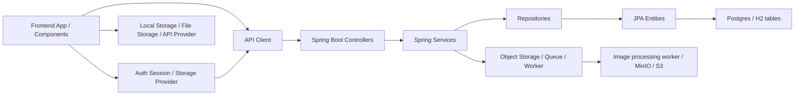
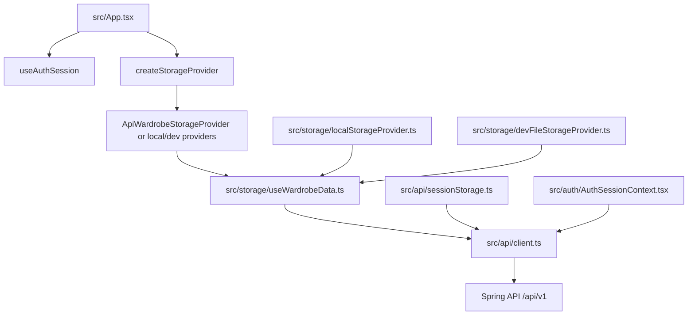
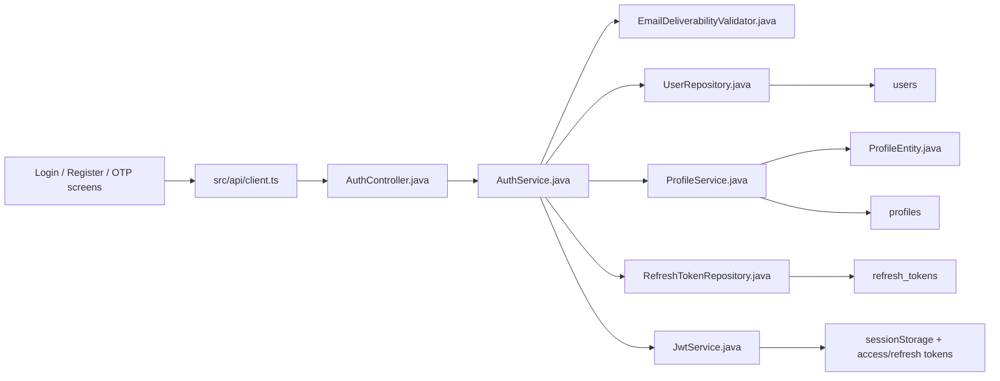
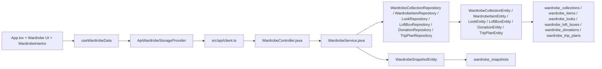
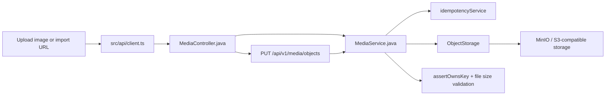
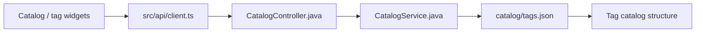
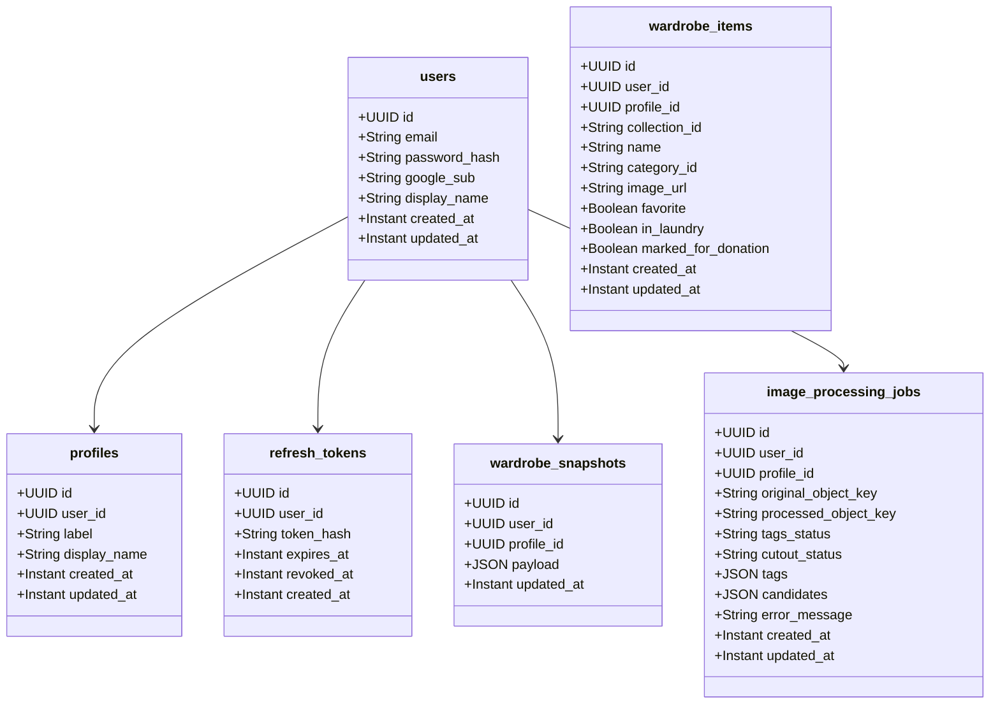

# Wardrobe Service & File Relationship Guide

This guide is intended as an onboarding map for the Wardrobe application. It shows the actual runtime flow from the frontend UI to backend controllers, services, repositories, entities, and database tables.

The goal is to help a new developer answer four questions quickly:

- Where does a feature start in the UI?
- Which API route and backend service handle it?
- Which repository / entity / table persists the data?
- Which conditions and validations are enforced before data is saved?

---

## 1) System-level map



### Primary front-end entry points

- `src/App.tsx` — main application shell and state orchestration
- `src/auth/AuthSessionContext.tsx` — auth state + token refresh logic
- `src/storage/useWardrobeData.ts` — wardrobe state + auto-save behavior
- `src/api/client.ts` — all REST API calls to the backend
- `src/api/wardrobeStorageProvider.ts` — decouples wardrobe persistence between local and API backends

### Primary backend entry points

- `backend/src/main/java/com/almirobe/auth/AuthController.java`
- `backend/src/main/java/com/almirobe/wardrobe/WardrobeController.java`
- `backend/src/main/java/com/almirobe/media/MediaController.java`
- `backend/src/main/java/com/almirobe/imagejob/ImageJobController.java`
- `backend/src/main/java/com/almirobe/catalog/CatalogController.java`

### Persistent data stores

- User and profile tables: `users`, `profiles`, `refresh_tokens`
- Wardrobe tables: `wardrobe_collections`, `wardrobe_items`, `wardrobe_looks`, `wardrobe_loft_boxes`, `wardrobe_donations`, `wardrobe_trip_plans`, `wardrobe_snapshots`
- Media processing: `image_processing_jobs`, `idempotency_keys`

---

## 2) App runtime structure and file relationships

### 2.1 Frontend session and data persistence



#### Notes

- `App.tsx` chooses the active storage provider based on auth mode and env config.
- `createStorageProvider.ts` switches between:
  - `api` provider (`src/api/wardrobeStorageProvider.ts`)
  - `local` provider (`src/storage/localStorageProvider.ts`)
  - dev file provider (`src/storage/devFileStorageProvider.ts`)
- `useWardrobeData.ts` persists all wardrobe changes with a debounce and flush-on-page-hide behavior. This is the canonical state wrapper around the app data.

#### Relevant files

- `src/storage/createStorageProvider.ts`
- `src/storage/useWardrobeData.ts`
- `src/api/wardrobeStorageProvider.ts`
- `src/api/client.ts`
- `src/api/sessionStorage.ts`

---

## 3) Authentication flow



### Flow description

1. Frontend app calls `apiClient.register()`, `login()`, `refreshSession()`, `me()`, `verifyPhoneOtp()`, etc.
2. `AuthController` receives the request from `/api/v1/auth/*`.
3. `AuthService` performs the business rules:
   - email normalization
   - duplicate email checks
   - password hash comparison
   - Google / OTP sign-in logic
   - profile creation via `ProfileService.ensureDefaultProfile()`
   - token issuance via `JwtService`
4. `UserRepository` and `ProfileRepository` persist rows into `users` and `profiles`.
5. Refresh tokens are stored in `refresh_tokens` via `RefreshTokenRepository`.

### Conditions and validation rules

- `AuthService.register()` calls `emailDeliverabilityValidator.validateForRegistration(email)` before creating a user.
- Internal domains such as `almirobe.local` are allowed intentionally for local / test users.
- `ProfileService.ensureDefaultProfile()` ensures each user has a default profile labeled `Me`.
- `JwtAuthenticationFilter` verifies bearer tokens for protected endpoints.

### Relevant files

- `src/auth/AuthSessionContext.tsx`
- `src/api/client.ts`
- `backend/src/main/java/com/almirobe/auth/AuthController.java`
- `backend/src/main/java/com/almirobe/auth/AuthService.java`
- `backend/src/main/java/com/almirobe/auth/EmailDeliverabilityValidator.java`
- `backend/src/main/java/com/almirobe/profile/ProfileService.java`
- `backend/src/main/java/com/almirobe/auth/UserEntity.java`
- `backend/src/main/java/com/almirobe/profile/ProfileEntity.java`
- `backend/src/main/resources/db/migration/V1__auth_and_profile.sql`

---

## 4) Wardrobe data flow



### Flow description

1. UI state is maintained in `useWardrobeData()`.
2. The active storage provider loads/saves the wardrobe object graph.
3. In API mode, `ApiWardrobeStorageProvider` calls `apiClient.getWardrobeSnapshot()` and `apiClient.saveWardrobeSnapshot()`.
4. `WardrobeController` exposes the wardrobe API endpoints under `/api/v1`:
   - `GET /wardrobe`
   - `POST /wardrobe`
   - `GET /items`
   - `POST /items`
   - `GET /looks`
   - `POST /looks`
   - `GET /lofts`
   - `POST /lofts`
   - `GET /donations`
   - `POST /donations`
   - `GET /trip-plans`
   - `POST /trip-plans`
5. `WardrobeService` handles item/collection/loft look/gift/trip data, serializes JSON nodes, and replaces the user’s wardrobe state in one transaction.
6. `WardrobeSnapshotEntity` records a whole snapshot payload keyed by `(user_id, profile_id)`.
7. Each domain collection is persisted in its own table with `user_id` + `profile_id` filtering.

### Core conditions

- `WardrobeController.requireUser()` throws if no authenticated user is present.
- `upsertSnapshot()` writes the full serialized snapshot and then replaces all related records for the current user/profile.
- `list*()` and `get*()` methods always filter by `user.userId()` and `user.profileId()`.
- Data is separated by profile, so the same user can have multiple wardrobe profiles.

### Relevant files

- `src/App.tsx`
- `src/storage/useWardrobeData.ts`
- `src/api/wardrobeStorageProvider.ts`
- `src/api/client.ts`
- `backend/src/main/java/com/almirobe/wardrobe/WardrobeController.java`
- `backend/src/main/java/com/almirobe/wardrobe/WardrobeService.java`
- `backend/src/main/java/com/almirobe/wardrobe/WardrobeSnapshotEntity.java`
- `backend/src/main/java/com/almirobe/wardrobe/WardrobeItemEntity.java`
- `backend/src/main/java/com/almirobe/wardrobe/WardrobeCollectionEntity.java`
- `backend/src/main/java/com/almirobe/wardrobe/LookEntity.java`
- `backend/src/main/java/com/almirobe/wardrobe/LoftBoxEntity.java`
- `backend/src/main/java/com/almirobe/wardrobe/DonationEntity.java`
- `backend/src/main/java/com/almirobe/wardrobe/TripPlanEntity.java`
- `backend/src/main/resources/db/migration/V4__wardrobe_snapshot.sql`
- `backend/src/main/resources/db/migration/V5__wardrobe_domain_tables.sql`

---

## 5) Media upload and object storage flow



### Flow description

1. The front end requests a pre-signed upload URL via `apiClient.createUploadUrl()`.
2. `MediaController.uploadUrl()` calls `mediaService.createUploadUrl(user, request, idempotencyKey, base)`.
3. `MediaService.createUploadUrl()` uses `IdempotencyService` to cache repeated upload requests and creates an object key with `ObjectStorage.allocateOriginalKey()`.
4. The browser uploads directly to `/api/v1/media/objects?key=...` via a `PUT`.
5. `MediaController.putObject()` verifies the object belongs to the current user (`assertOwnsKey`) and writes the file into object storage.
6. Later, the app can reference the saved image URL from `ObjectStorage.publicGetUrl()`.

### Conditions and validation rules

- User must be authenticated.
- Uploaded file must not be empty.
- Uploaded file must be <= 10MB.
- `assertOwnsKey()` rejects any storage key not starting with `originals/{userId}/` or `processed/{userId}/`.
- `createUploadUrl()` uses idempotent request keys for repeat submissions.

### Relevant files

- `src/api/client.ts`
- `backend/src/main/java/com/almirobe/media/MediaController.java`
- `backend/src/main/java/com/almirobe/media/MediaService.java`
- `backend/src/main/java/com/almirobe/storage/ObjectStorage.java`
- `backend/src/main/java/com/almirobe/idempotency/IdempotencyService.java`
- `backend/src/main/java/com/almirobe/idempotency/IdempotencyKeyEntity.java`

---

## 6) Image job processing flow

```mermaid
flowchart LR
    UI[Create image job in UI] --> API[src/api/client.ts]
    API --> CTRL[ImageJobController.java]
    CTRL --> SVC[ImageJobService.java]
    SVC --> VALID[assertOwnsKey + objectStorage.exists]
    SVC --> JOB[ImageProcessingJobEntity]
    JOB --> JOBTBL[image_processing_jobs]
    SVC --> QUEUE[JobQueue]
    QUEUE --> WORKER[worker service / Python worker]
    WORKER --> STORAGE[ObjectStorage]
    WORKER --> RESULT[queue result payload]
    RESULT --> SVC
    SVC --> GET[getImageJob()]
```

### Flow description

1. The app sends a create-image-job request to `POST /api/v1/image-jobs`.
2. `ImageJobController.create()` delegates to `ImageJobService.create()`.
3. `ImageJobService.create()` verifies the input object belongs to the user and exists in object storage.
4. A new `ImageProcessingJobEntity` row is inserted with statuses:
   - `tags_status`
   - `cutout_status`
5. The service enqueues a processing task to `JobQueue`.
6. The worker processes the image and writes output to the processed object path.
7. The worker writes a result payload back to `JobQueue`.
8. `ImageJobService.get()` polls or syncs the job state and returns the latest status to the UI.

### Tags and processing states

- `TrackStatus.QUEUED`
- `TrackStatus.RUNNING`
- `TrackStatus.SUCCEEDED`
- `TrackStatus.FAILED`
- `ImageJobService.applyQueueResult()` combines queue output into `tags` and `candidates` JSON fields, and updates processed object key and error message.

### Relevant files

- `src/api/client.ts`
- `backend/src/main/java/com/almirobe/imagejob/ImageJobController.java`
- `backend/src/main/java/com/almirobe/imagejob/ImageJobService.java`
- `backend/src/main/java/com/almirobe/imagejob/ImageProcessingJobEntity.java`
- `backend/src/main/resources/db/migration/V2__image_jobs.sql`
- `backend/src/main/java/com/almirobe/queue/JobQueue.java`
- `worker/` Python job worker files

---

## 7) Catalog tags flow



### Flow description

- `CatalogController` exposes `GET /api/v1/catalog/tags`.
- `CatalogService` loads `catalog/tags.json` from the classpath.
- The JSON file holds the static catalog used for tags, categories, and filters.

### Relevant files

- `src/api/client.ts`
- `backend/src/main/java/com/almirobe/catalog/CatalogController.java`
- `backend/src/main/java/com/almirobe/catalog/CatalogService.java`
- `catalog/tags.json`

---

## 8) Database map by table



### Table relationships

- `users` is the root identity table.
- `profiles` is a per-user profile dimension and is created automatically when a user logs in/registers.
- `refresh_tokens` belong to a user and are invalidated on logout or refresh.
- `wardrobe_snapshots` stores a complete serialized snapshot for each `(user_id, profile_id)` pair.
- `wardrobe_items`, `wardrobe_collections`, `wardrobe_looks`, `wardrobe_loft_boxes`, `wardrobe_donations`, `wardrobe_trip_plans` each store a specific wardrobe domain area keyed by the same user/profile pair.
- `image_processing_jobs` stores background image processing state and result payloads.

---

## 9) File-to-file dependency map

| Layer | Main files | Responsibility |
| --- | --- | --- |
| UI shell | `src/App.tsx` | Main app state, view switching, modal orchestration |
| Auth UI | `src/auth/*` | Auth provider, session state, token handling |
| Storage | `src/storage/*` | Local/dev/API persistence abstractions |
| API layer | `src/api/client.ts`, `src/api/wardrobeStorageProvider.ts` | REST calls and storage provider implementation |
| Controller | `backend/src/main/java/com/almirobe/*/*Controller.java` | Request handling |
| Service | `backend/src/main/java/com/almirobe/*/*Service.java` | Business rules and transaction orchestration |
| Repository | `backend/src/main/java/com/almirobe/*/*Repository.java` | Data access |
| Entity | `backend/src/main/java/com/almirobe/*/*Entity.java` | JPA mapping to DB tables |
| DB | `backend/src/main/resources/db/migration/*.sql` | Schema and migration definitions |

### Example dependency chain

- `src/App.tsx` → `src/storage/useWardrobeData.ts` → `src/api/wardrobeStorageProvider.ts` → `src/api/client.ts` → `WardrobeController.java` → `WardrobeService.java` → `WardrobeItemRepository.java` → `WardrobeItemEntity.java` → `wardrobe_items`
- `src/App.tsx` → `src/auth/AuthSessionContext.tsx` → `src/api/client.ts` → `AuthController.java` → `AuthService.java` → `UserRepository.java` / `ProfileRepository.java` → `users` / `profiles`
- `src/api/client.ts` → `MediaController.java` → `MediaService.java` → `ObjectStorage` → `MinIO/S3` / uploaded object keys
- `src/api/client.ts` → `ImageJobController.java` → `ImageJobService.java` → `ImageProcessingJobRepository.java` → `image_processing_jobs` → `JobQueue` → worker

---

## 10) Key conditions to remember while onboarding

- Auth is required for protected endpoints.
- `AuthenticatedUser` is injected by Spring security and includes `userId` and `profileId`.
- All wardrobe queries enforce `user_id` and `profile_id` filtering.
- All uploads are validated against the current user’s object key namespace.
- Image jobs are tied to the user and profile for ownership checks and result retrieval.
- Snapshot storage is the whole-wardrobe ledger for the profile; domain tables are the concrete records that are read and rewritten.
- The system uses profile scoping rather than single-user storage, which is important when updating or deleting items.

---

## 11) Short onboarding checklist

When you are assigned a feature, trace it in this order:

1. Identify the UI entry point in `src/App.tsx` or related feature folder.
2. Find the API client call in `src/api/client.ts` or its feature provider.
3. Read the matching controller in `backend/src/main/java/com/almirobe/.../*Controller.java`.
4. Read the service in the same package for business rules and validation.
5. Find the repository and entity used for persistence.
6. Confirm the DB schema in `backend/src/main/resources/db/migration/*.sql`.
7. Check related guards: auth ownership, profile filtering, idempotency, object ownership, and queue processing.

This step-by-step path will let you understand the system without reading every file at once.

---

## 12) One-line summary

The application is a profile-scoped wardrobe system: frontend state is persisted through storage providers, transported via typed API clients, handled by Spring controllers and services, and persisted in user/profile-scoped JPA entities and migration-defined database tables.

